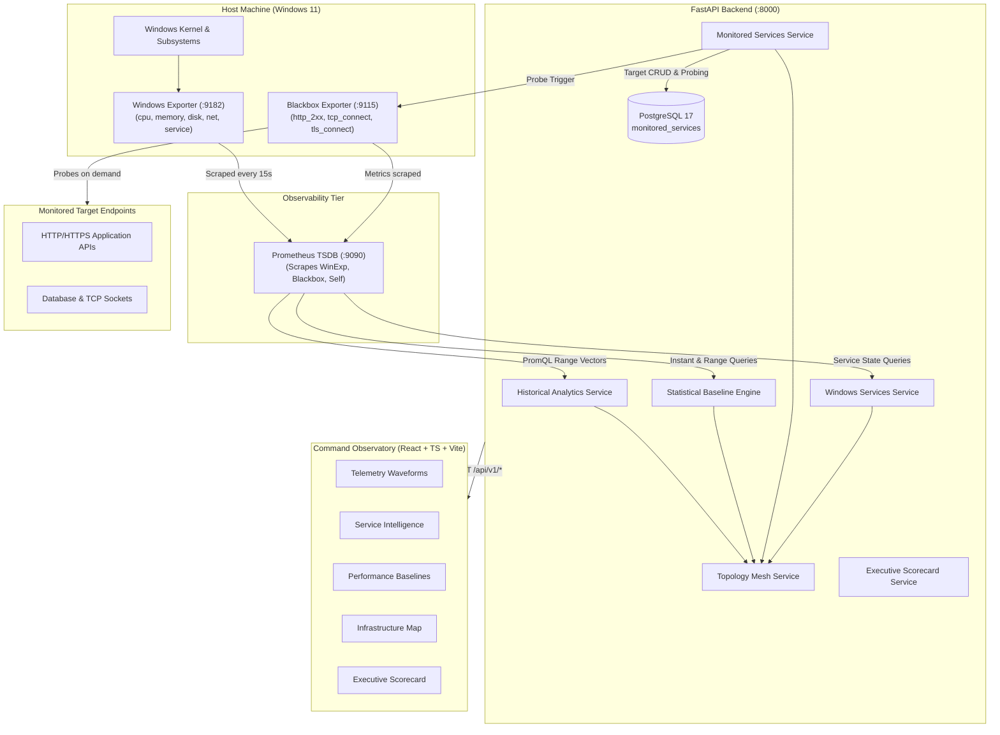

# SentinelOps — Phase 3 Implementation Report
## Advanced Telemetry, Infrastructure Intelligence & Performance Baselines

**Product**: SentinelOps — AI-Powered Infrastructure Monitoring & AIOps Platform  
**Tagline**: *"Observe. Detect. Investigate. Resolve."*  
**Architecture Phase**: Phase 3 (Advanced Telemetry & Infrastructure Intelligence)  
**Execution Timestamp**: 2026-11-15  
**Platform**: Windows Host Native Exporters, Prometheus TSDB, FastAPI Async Backend, React + TypeScript Vite Frontend  

---

## 1. Executive Summary

Phase 3 transforms **SentinelOps** from a real-time host metric viewer into an advanced observability and infrastructure intelligence platform. The system now understands:
1. **Behavior Over Time**: Prometheus-backed range vector historical telemetry across CPU compute, physical RAM, logical disk space/throughput, and network interfaces with selectable time windows (`15m`, `1h`, `6h`, `24h`, `7d`).
2. **Service Availability & Reliability**: Prometheus Blackbox Exporter integration (`http_2xx`, `http_post_2xx`, `tcp_connect`, `tls_connect`) with direct fallback probing, persistent PostgreSQL target storage, and strict SSRF protection.
3. **Host Service Health**: Deep Windows service collector monitoring tracking operational states (`RUNNING`, `STOPPED`), startup configurations (`auto`, `manual`, `disabled`), and service run-as identities.
4. **Statistical Performance Baselines**: Autonomous mathematical baseline engine computing sample mean ($\mu$), median, sample standard deviation ($\sigma$), 5-sample moving rolling averages, and Z-score deviation triggers ($Z = \frac{x - \mu}{\sigma}$). Evaluates whether current operating performance deviates significantly from historical envelopes without fabricating operational metrics.
5. **Infrastructure Relationship Topology**: Real-time connected graph model discovering Host, OS, Windows Exporter, Blackbox Exporter, Prometheus TSDB, FastAPI Backend, PostgreSQL Database, and Monitored Application Targets with directed dependency flows.
6. **Command Observatory Workspaces**: Bespoke technical interfaces providing high-density SVG telemetry waveforms, interactive target management modals, statistical baseline matrices with visual distribution indicators, and an interactive topology canvas with a live node inspector drawer.

---

## 2. Architecture & Component Interaction

---

## 3. Detailed Implementations

### 3.1 Historical Telemetry Engine

- **PromQL Range Vector Queries**:
  - **CPU**: `100 - (avg(irate(windows_cpu_time_seconds_total{mode="idle"}[1m])) * 100)` with per-core breakdown.
  - **Memory**: Physical memory utilization percentage, used bytes, and available bytes.
  - **Disk**: Logical volume space utilization percentage and read/write I/O byte rates.
  - **Network**: Incoming (Rx) and outgoing (Tx) byte transfer rates across active network adapters.
- **Selectable Time Windows**:
  - `15m`: 15-second step resolution (~60 samples)
  - `1h`: 30-second step resolution (~120 samples)
  - `6h`: 2-minute step resolution (~180 samples)
  - `24h`: 10-minute step resolution (~144 samples)
  - `7d`: 1-hour step resolution (~168 samples)
- **Statistical Descriptors**:
  - Arithmetic mean ($\mu$), median, minimum floor, maximum peak, standard deviation ($\sigma$).
  - Moving 5-sample rolling average.
  - Trend trajectory calculation: `SURGING` ($> +15\%$), `INCREASING` ($> +3\%$), `DECREASING` ($< -3\%$), `STABLE` (within $\pm 3\%$), or `QUIET`.
  - Strict input validation rejecting unwhitelisted duration parameters with HTTP 422.

### 3.2 Service Availability Monitoring (Blackbox Exporter)

- **Native Exporter Deployment**:
  - Prometheus Blackbox Exporter v0.25.0 installed and running natively as background daemon on port `9115`.
  - Configured modules in `infrastructure/blackbox_exporter/blackbox.yml`:
    - `http_2xx`: HTTP/1.1 and HTTP/2 GET probes with TLS certificate validation.
    - `http_post_2xx`: HTTP POST synthetic queries.
    - `tcp_connect`: Raw TCP socket handshake and connect latency probes.
    - `tls_connect`: TLS certificate handshake and expiry diagnostics.
- **Direct Fallback Prober**:
  - If Blackbox Exporter is temporarily unreachable, SentinelOps executes a direct native probe using `httpx.AsyncClient` or `asyncio.open_connection`, ensuring probe resilience without reporting false downtime.
- **PostgreSQL Persistence & Alembic Migration**:
  - Created SQLAlchemy model `MonitoredServiceRecord` (`monitored_services` table) persisting service targets, probe intervals, timeout thresholds, tags, and status criteria.
  - Created Alembic migration `0004_add_monitored_services.py`.
- **SSRF Prevention Architecture**:
  - Custom target URL validator rejects loopback cloud metadata addresses (`169.254.169.254`, `metadata.google.internal`, `metadata.azure.com`, `[fd00:ec2::254]`) with HTTP 422 validation errors.
  - Enforces explicit protocol whitelisting (HTTP, HTTPS, or host:port TCP format).

### 3.3 Windows Host Services Monitoring

- **Windows Exporter Collector Update**:
  - Re-launched `windows_exporter.exe` with the `service` collector enabled (`--collectors.enabled="cpu,memory,logical_disk,net,os,system,service"`).
  - Telemetry service queries Prometheus for `windows_service_info`, `windows_service_state`, and `windows_service_start_mode`.
  - Exposes `GET /api/v1/services/windows/overview` returning operational running states, startup mode (auto, manual, disabled), health evaluation, and run-as accounts.

### 3.4 Performance Baseline Engine

- **Statistical Anomaly Scoring**:
  - Analyzes historical distributions over a 24-hour training window.
  - Calculates standard score:
    $$Z = \frac{x - \mu}{\sigma}$$
  - **Threshold Envelopes**:
    - `NOMINAL`: $|Z| < 2.0$ (within normal $2\sigma$ envelope).
    - `WARNING_DEVIATION`: $2.0 \le |Z| < 3.0$ (statistically elevated increase or decrease).
    - `CRITICAL_DEVIATION`: $|Z| \ge 3.0$ (critical surge or drop exceeding $3\sigma$).
  - **Insufficient Data Safeguard**:
    - If the number of historical sample points is less than `BASELINE_MIN_DATA_POINTS` (10), the engine explicitly returns `deviation_status: "INSUFFICIENT_DATA"` and `has_sufficient_data: false`.
    - Never fabricates baseline numbers or converts missing telemetry to 0.

### 3.5 Infrastructure Relationship Topology

- **Dynamic Discovery & Dependency Model**:
  - Host Server $\rightarrow$ Operating System (runs on)
  - Host Server $\rightarrow$ Windows Exporter (hosts)
  - Host Server $\rightarrow$ Blackbox Exporter (hosts)
  - Windows Exporter $\rightarrow$ Prometheus (scraped by)
  - Blackbox Exporter $\rightarrow$ Prometheus (scraped by)
  - Prometheus $\rightarrow$ FastAPI Backend (queried by)
  - FastAPI Backend $\rightarrow$ PostgreSQL Database (persisted by)
  - Blackbox Exporter / Backend $\rightarrow$ User Monitored Service Targets (probes)
- **Topological Metadata**:
  - Real component states (`HEALTHY`, `WARNING`, `CRITICAL`, `UNKNOWN`).
  - Network addresses, ports, runtime parameters, scrape intervals, and active connections.

### 3.6 Frontend Command Observatory Workspaces

- **Telemetry Explorer (`telemetry-explorer`)**:
  - Interactive subsystem tabs: CPU Compute, Physical RAM, Logical Disk, Network I/O.
  - Time range selector (`15M`, `1H`, `6H`, `24H`, `7D`).
  - Scorecard readouts for live value, arithmetic mean ($\mu$), median, minimum floor, maximum peak, and trend trajectory.
  - High-density SVG telemetry waveform with gradient fill, dashed mean reference line, and interactive mouse-scrubbing tooltip.
- **Service Intelligence (`services`)**:
  - Synthetic probe availability banner (Total Active Targets, Online UP, Failing DOWN, Availability SLA %).
  - Target Registration modal with client-side SSRF validation and protocol configuration.
  - Monitored Services table showing status badge, HTTP code, latency (ms), TLS certificate expiry days, and instant probe trigger.
  - Windows Services telemetry accordion table.
- **Performance Baselines (`baselines`)**:
  - Subsystem baseline model scorecards.
  - Metric readout with historical mean, median, standard deviation ($\sigma$), rolling average, and live value.
  - Visual standard deviation bell gauge rendering live position across $[-3\sigma, +3\sigma]$.
  - Deviation alert messages explaining surge or drop magnitude.
- **Infrastructure Map (`infrastructure`)**:
  - Live SVG architecture canvas rendering nodes and animated directed relationship edges.
  - Category filters: All Nodes, Infrastructure, Observability, Platform.
  - Interactive Node Inspector drawer displaying full diagnostic metadata attributes and connectivity links.
- **Executive Telemetry Scorecard (`ExecutiveSummaryBanner`)**:
  - Embedded in Command Canvas showing overall stability index (0-100%), synthetic probe availability %, critical trends, and quick navigation shortcuts.

---

## 4. Verification & Testing

### 4.1 Automated Backend Test Suite (Pytest)

- **Total Tests Executed**: 46
- **Passed**: 46 (100% pass rate)
- **Execution Time**: ~50 seconds

| Test Suite | Description | Status |
|:---|:---|:---:|
| `test_phase3_advanced.py::test_historical_analytics_cpu_memory_disk_network` | Historical endpoints across CPU, RAM, Disk, Net with time ranges | **PASSED** |
| `test_phase3_advanced.py::test_historical_analytics_invalid_range` | Strict HTTP 422 rejection for invalid duration query parameters | **PASSED** |
| `test_phase3_advanced.py::test_performance_baselines_insufficient_data` | Explicit `INSUFFICIENT_DATA` response when sample count < 10 | **PASSED** |
| `test_phase3_advanced.py::test_performance_baselines_nominal_and_anomalous` | Statistical mean, median, $\sigma$, and Z-score deviation triggers ($|Z| \ge 3.0$) | **PASSED** |
| `test_phase3_advanced.py::test_baselines_endpoint` | `GET /api/v1/analytics/baselines` validation | **PASSED** |
| `test_phase3_advanced.py::test_analytics_summary_endpoint` | `GET /api/v1/analytics/summary` stability index and trends | **PASSED** |
| `test_phase3_advanced.py::test_monitored_services_crud_and_ssrf` | Service target CRUD, 204 delete, and SSRF metadata blocking | **PASSED** |
| `test_phase3_advanced.py::test_windows_services_overview` | `GET /api/v1/services/windows/overview` service state telemetry | **PASSED** |
| `test_phase3_advanced.py::test_infrastructure_topology_endpoint` | `GET /api/v1/topology` graph nodes, directed edges, and summary | **PASSED** |
| `test_monitoring_prometheus.py` (8 tests) | Prometheus client queries, thresholds, and offline fallbacks | **PASSED** |
| `test_health.py` (7 tests) | Liveness, readiness, system info, correlation IDs, CORS | **PASSED** |
| `test_metrics.py` (6 tests) | Real-time metric collectors, current/history/summary, Prometheus export | **PASSED** |
| `test_logs.py` (4 tests) | Log ingestion, filtering, and database persistence | **PASSED** |
| `test_anomalies.py` (6 tests) | Isolation Forest anomaly scoring and retrain endpoints | **PASSED** |
| `test_config_exceptions.py` (5 tests) | Centralized error handling, custom exceptions, CORS parsing | **PASSED** |
| `test_database.py` (1 test) | Database health audit model persistence | **PASSED** |

### 4.2 Frontend Build Validation

- Command: `npm --prefix frontend run build`
- TypeScript Compiler (`tsc`): **0 errors**
- Vite Production Build: **Completed in 8.92s**
  - `dist/index.html`: 1.40 kB
  - `dist/assets/index-*.css`: 35.68 kB (gzip: 6.84 kB)
  - `dist/assets/index-*.js`: 455.54 kB (gzip: 116.17 kB)

### 4.3 Live End-to-End System Verification

Executed `python scripts/verify_phase3.py`:
- `[+] Prometheus (port 9090)`: HTTP 200 READY
- `[+] Windows Exporter (port 9182)`: HTTP 200 (Service collector: ACTIVE)
- `[+] Blackbox Exporter (port 9115)`: HTTP 200 ACTIVE
- `[+] Blackbox Probe Test`: HTTP 200 (`probe_success=1`: True)
- `[+] Liveness Probe`: HTTP 200 OK
- `[+] CPU History (15m)`: HTTP 200 OK
- `[+] Memory History (1h)`: HTTP 200 OK
- `[+] Disk History (6h)`: HTTP 200 OK
- `[+] Network History (24h)`: HTTP 200 OK
- `[+] Statistical Baselines`: HTTP 200 OK
- `[+] Executive Summary`: HTTP 200 OK
- `[+] Monitored Services List`: HTTP 200 OK
- `[+] Windows Services Overview`: HTTP 200 OK
- `[+] Infrastructure Topology`: HTTP 200 OK

---

## 5. Summary of Created & Modified Artifacts

| Category | File | Description |
|:---|:---|:---|
| **Infrastructure** | `infrastructure/blackbox_exporter/blackbox.yml` | Blackbox Exporter probe modules (`http_2xx`, `tcp_connect`, `tls_connect`) |
| | `infrastructure/prometheus/prometheus.yml` | Scrape config including windows_exporter, blackbox_exporter, self |
| | `infrastructure/prometheus/prometheus.local.yml` | Local Prometheus configuration with 15s scrape interval |
| | `scripts/install_blackbox_exporter.ps1` | PowerShell installer script for Blackbox Exporter v0.25.0 |
| | `scripts/start_blackbox_exporter.ps1` | Launch script for Blackbox Exporter on port 9115 |
| | `scripts/stop_blackbox_exporter.ps1` | Process termination script for Blackbox Exporter |
| | `scripts/start_windows_exporter.ps1` | Updated to include `service` collector |
| | `scripts/verify_phase3.py` | Automated live verification harness |
| **Backend Core** | `backend/app/core/config.py` | Added Blackbox Exporter and Baseline engine settings |
| | `backend/app/core/exceptions.py` | Sanitized validation exceptions with `jsonable_encoder` |
| | `backend/app/main.py` | Configured Windows event loop policy and routers |
| **Backend Database** | `backend/app/models/services.py` | SQLAlchemy model `MonitoredServiceRecord` |
| | `backend/alembic/versions/0004_add_monitored_services.py` | Alembic migration for `monitored_services` table |
| **Backend Schemas** | `backend/app/schemas/services.py` | Schemas for target CRUD, SSRF protection, Windows services |
| | `backend/app/schemas/analytics.py` | Schemas for historical range series, baselines, summary |
| | `backend/app/schemas/topology.py` | Schemas for graph nodes, directed edges, and health summary |
| **Backend Services** | `backend/app/services/monitored_service_service.py` | Target CRUD, Blackbox probing, direct fallback probe |
| | `backend/app/services/windows_services_service.py` | Windows service collector query service |
| | `backend/app/services/historical_analytics_service.py` | Historical PromQL range vector query service |
| | `backend/app/services/baseline_service.py` | Statistical baseline ($\mu, \sigma$, median, Z-score) service |
| | `backend/app/services/topology_service.py` | Dynamic infrastructure relationship topology synthesis |
| | `backend/app/services/analytics_summary_service.py` | Executive stability index & trend scorecard service |
| **Backend Endpoints**| `backend/app/api/v1/endpoints/analytics.py` | Endpoints for `/history`, `/baselines`, `/summary` |
| | `backend/app/api/v1/endpoints/services.py` | CRUD endpoints for `/services` and `/windows/overview` |
| | `backend/app/api/v1/endpoints/topology.py` | Endpoint for `/topology` relationship graph |
| **Backend Tests** | `backend/tests/test_phase3_advanced.py` | 9 comprehensive tests for Phase 3 endpoints & baselines |
| **Frontend Types** | `frontend/src/types/services.ts` | TypeScript types for services & Windows services |
| | `frontend/src/types/analytics.ts` | TypeScript types for historical telemetry & baselines |
| | `frontend/src/types/topology.ts` | TypeScript types for topology graph nodes & edges |
| **Frontend Services**| `frontend/src/services/serviceMonitoringService.ts` | Client API for monitored services |
| | `frontend/src/services/analyticsService.ts` | Client API for historical telemetry & baselines |
| | `frontend/src/services/topologyService.ts` | Client API for infrastructure topology |
| **Frontend Hooks** | `frontend/src/hooks/useHistoricalTelemetry.ts` | Historical telemetry hook with time-range switching |
| | `frontend/src/hooks/useServiceIntelligence.ts` | Service intelligence hook with CRUD and probing |
| | `frontend/src/hooks/useBaselines.ts` | Statistical baselines hook |
| | `frontend/src/hooks/useTopology.ts` | Infrastructure topology mesh hook |
| **Frontend UI** | `frontend/src/components/observatory/TelemetryExplorer.tsx` | High-density SVG telemetry waveforms & range controls |
| | `frontend/src/components/observatory/ServiceIntelligence.tsx` | Target management, status badges, probe modal |
| | `frontend/src/components/observatory/PerformanceBaselines.tsx` | Statistical matrix with visual Z-score distribution gauges |
| | `frontend/src/components/observatory/InfrastructureMap.tsx` | Interactive topology canvas with node inspector drawer |
| | `frontend/src/components/observatory/ExecutiveSummaryBanner.tsx` | Top-level stability index and trend summary |
| | `frontend/src/components/layout/Sidebar.tsx` | Updated navigation rail with dedicated workspace links |
| | `frontend/src/App.tsx` | Workspace routing for all Phase 3 views |
