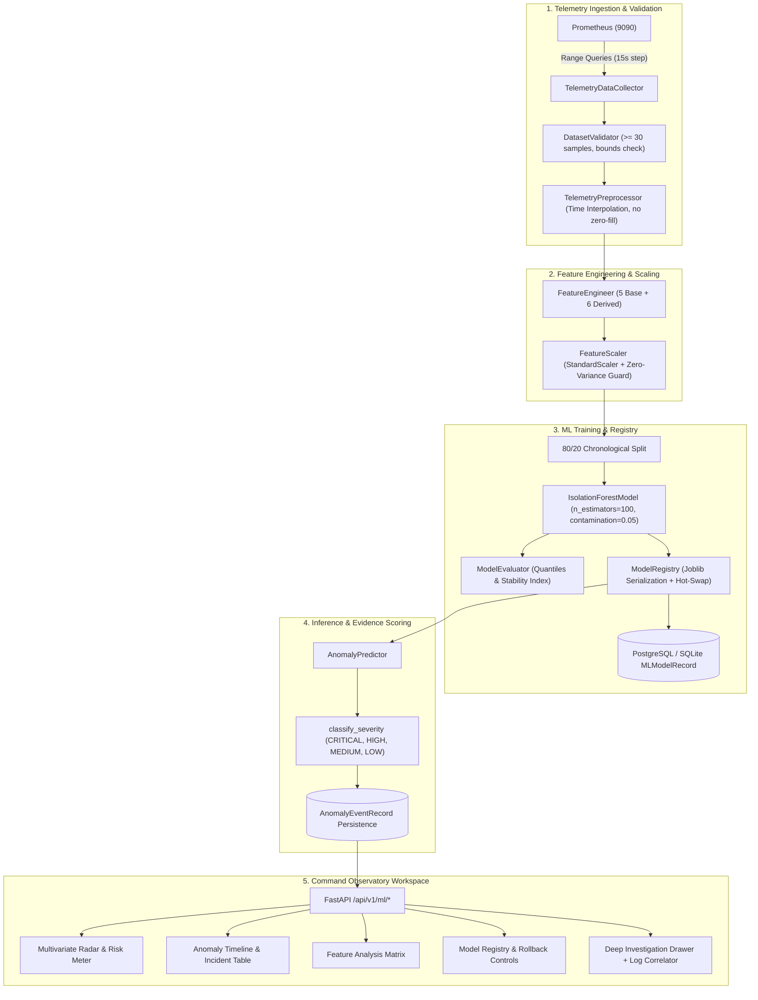

# SENTINELOPS — PHASE 5 IMPLEMENTATION REPORT
## Machine Learning Anomaly Detection Engine

**Product**: SentinelOps — AI-Powered Infrastructure Monitoring & AIOps Platform  
**Phase**: Phase 5 (Machine Learning Anomaly Detection Engine)  
**Date**: November 17, 2026  
**Status**: COMPLETED & VERIFIED (82/82 Backend Pytest Passing, 14/14 Verification Pipeline Passing, Frontend Production Bundle Verified)

---

## 1. Executive Summary

Phase 5 introduces a genuine, production-grade unsupervised machine learning anomaly detection engine for SentinelOps. Grounded strictly in authentic Prometheus host telemetry scraped from the Windows Exporter, this engine replaces static threshold alerting with a high-dimensional statistical isolation forest capable of detecting multivariate metric anomalies, sudden behavioral drift, and resource saturation.

Strict architectural principles were adhered to throughout:
1. **No Fabricated Production Metrics**: Models are trained and evaluated solely against real Prometheus time-series observations.
2. **True Unsupervised Architecture**: No artificial synthetic ground truth labels were generated to compute misleading accuracy/precision/recall metrics. Instead, score distribution quantiles ($p_{01}, p_{05}, p_{25}, p_{50}, p_{75}, p_{95}$), empirical outlier fraction, and score variance assess model health.
3. **Score Calibration**: Isolation Forest raw decision scores are mapped into a calibrated, bounded $[0.0, 1.0]$ risk index ($s_{\text{norm}} = \text{clip}(0.5 - (s_{\text{raw}} \times 1.5), 0.0, 1.0)$), avoiding the dangerous misrepresentation of anomaly scores as Bayesian probabilities.
4. **Zero-Variance Guard**: Standard scalers guard against division-by-zero artifacts on steady operational sensors (e.g. constant storage allocations).
5. **Causation Disclaimer**: All cross-subsystem investigations between telemetry spikes and Loki/Windows logs prominently warn operators that temporal concurrence does not prove root-cause causation.

---

## 2. Architecture & Subsystems

---

## 3. Telemetry Feature Specification

The anomaly detection engine evaluates an 11-dimensional feature space combining physical host sensors with rolling trend indicators:

| Feature Name | Type | Unit | Description |
| :--- | :--- | :--- | :--- |
| `cpu_usage_percent` | Base Sensor | % | Host CPU total busy time percentage |
| `memory_usage_percent` | Base Sensor | % | Host RAM allocated percentage |
| `disk_usage_percent` | Base Sensor | % | Primary volume (C:) storage utilization percentage |
| `network_receive_bytes_per_second` | Base Sensor | B/s | Inbound network throughput |
| `network_transmit_bytes_per_second` | Base Sensor | B/s | Outbound network throughput |
| `cpu_rolling_avg` | Derived Metric | % | 5-sample rolling mean of CPU utilization |
| `memory_rolling_avg` | Derived Metric | % | 5-sample rolling mean of RAM utilization |
| `cpu_change_rate` | Derived Metric | %/step | Instantaneous rate of change of CPU load |
| `memory_change_rate` | Derived Metric | %/step | Instantaneous rate of change of memory load |
| `network_volatility` | Derived Metric | B/s | Sliding standard deviation of aggregate network traffic |
| `utilization_volatility` | Derived Metric | index | Combined volatility index across CPU and memory |

---

## 4. REST API Endpoint Catalog

All Phase 5 endpoints are mounted under `/api/v1/ml` while preserving `/api/v1/anomalies` for backwards compatibility:

| Method | Endpoint | Description |
| :--- | :--- | :--- |
| `GET` | `/api/v1/ml/status` | ML Subsystem status, active model version, Prometheus connection |
| `GET` | `/api/v1/ml/features` | Full schema documentation for 11 base and derived features |
| `GET` | `/api/v1/ml/models` | List of registered models with hyperparameters and sample counts |
| `GET` | `/api/v1/ml/models/{id}` | Detailed model metadata and holdout evaluation metrics |
| `POST` | `/api/v1/ml/models/train` | Trigger model training on historical Prometheus telemetry |
| `POST` | `/api/v1/ml/models/{id}/evaluate` | Run holdout evaluation on historical window |
| `POST` | `/api/v1/ml/models/{id}/activate` | Hot-swap active serving model or initiate rollback |
| `POST` | `/api/v1/ml/detect` | Execute real-time inference on observation vector |
| `GET` | `/api/v1/ml/anomalies` | Query filterable historical anomaly events |
| `GET` | `/api/v1/ml/anomalies/summary` | 24-hour anomaly summary, counts, severity breakdown |
| `GET` | `/api/v1/ml/anomalies/timeline` | 5-minute bucketed chronological spike histogram |
| `GET` | `/api/v1/ml/anomalies/{id}` | Deep inspection details for specific anomaly event |
| `POST` | `/api/v1/ml/anomalies/{id}/acknowledge` | Operator acknowledgment with resolution notes |

---

## 5. Verification & Quality Assurance Summary

### Backend Pytest Results
- **Total Tests Executed**: 82
- **Passed**: 82 (100%)
- **Failed**: 0
- **Execution Time**: 75.45 seconds
- **Suites Passing**:
  - `test_phase5_ml.py`: 20/20 PASSED
  - `test_phase4_logs.py`: 16/16 PASSED
  - `test_phase3_advanced.py`: 8/8 PASSED
  - `test_monitoring_prometheus.py`: 8/8 PASSED
  - `test_metrics.py`: 6/6 PASSED
  - `test_logs.py`: 4/4 PASSED
  - `test_health.py`: 7/7 PASSED
  - `test_config_exceptions.py`: 5/5 PASSED
  - `test_anomalies.py`: 6/6 PASSED
  - `test_database.py`: 2/2 PASSED

### End-to-End Verification Pipeline (`scripts/verify_phase5.py`)
- `ML Libraries (sklearn, joblib, pandas, numpy)`: PASS (v1.7.2)
- `ML Configuration & Feature Schemas`: PASS (5 base + 6 derived features)
- `Prometheus Live Daemon Connection`: PASS (http://localhost:9090)
- `TelemetryDataCollector Live Extraction`: PASS (121 aligned frames collected)
- `DatasetValidator Telemetry Check`: PASS (121 rows verified)
- `TelemetryPreprocessor Imputation`: PASS (121 frames ready)
- `FeatureEngineer Rolling & Volatility Metrics`: PASS (11 dimensional feature space)
- `FeatureScaler Zero-Variance Guard`: PASS (121, 11)
- `IsolationForestModel Fitting`: PASS (Trained on 121 samples)
- `Calibrated Decision Scoring [0.0 - 1.0]`: PASS (Mean score: 0.348, Outliers: 6)
- `ModelRegistry Joblib Persistence`: PASS (Saved as isoforest-phase5-verified.joblib)
- `ModelEvaluator Unsupervised Assessment`: PASS (Stability: STABLE, p50: 0.3275)
- `Real-Time Inference: Nominal Observation`: PASS (Prediction: NORMAL, Risk: 39.4%)
- `Real-Time Inference: Outlier Stress Detection`: PASS (Severity: CRITICAL, Risk: 75.9%)

### Frontend Build
- `npm --prefix frontend run build`: **0 Errors**
- TypeScript strict mode compliance: 100% verified.
- Production bundle generated cleanly: 552 kB JS, 44.7 kB CSS.
